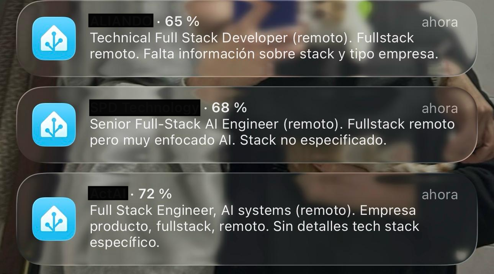
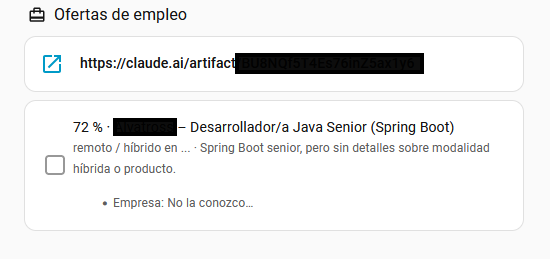
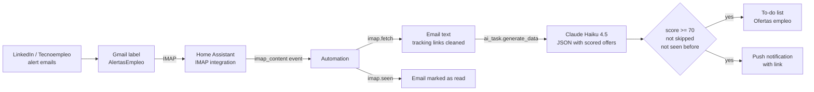

# Job alert bot for Home Assistant

A Home Assistant automation that reads my job-alert emails, asks Claude to score every offer against my profile, and only tells me about the ones worth applying to.

I was getting dozens of LinkedIn and Tecnoempleo alerts a day, and most of them didn't match what I was looking for. Now my phone only buzzes for the offers that fit: the kind of company I want, remote work in Spain, and a stack I actually use.

## What you see

### On the phone

Every good offer arrives as a push notification from the Home Assistant app. The title has the company and the score, the text has the role, the work mode and why it fits. Tapping it opens the offer.



```
WorkFlex · 82 %
Full-Stack Software Engineer – AI First (Angular and Java) (remoto).
Java y Angular, producto HR tech
```

### In Home Assistant

The offers are also saved in a to-do list called **Ofertas empleo**, on the dashboard. Each item starts with the score, so the list is sorted with the best offers on top. The description has the details and the link:



```
82 % · WorkFlex – Full-Stack Software Engineer – AI First (Angular and Java)

remoto · Java y Angular, producto HR tech

- Empresa: Plataforma SaaS para trabajar desde el extranjero sin riesgos legales
- Stack: Java, Angular
- Salario: No indicado
- Idioma: Inglés

https://www.linkedin.com/comm/jobs/view/4461074118/
```

When I apply to an offer, I tick it in the list. Ticked offers stay there, so the bot never adds them again.

## What it does

- **Reads alert emails** from a Gmail label over IMAP, as soon as they arrive.
- **Extracts every offer** in the email (company, role, work mode, link) with Claude Haiku 4.5, through Home Assistant's `ai_task.generate_data`.
- **Scores each offer from 0 to 100** against my profile and rules: type of company, remote from Spain, Java/Spring Boot or full-stack Angular/React.
- **Skips companies you're not interested in**, from a list you write yourself.
- **Adds extra details** to each offer: what the company does, stack, salary and language, only when the email says so. The prompt tells the model not to invent them.
- **Keeps a to-do list** in Home Assistant with every good offer, sorted by score, and never adds the same offer twice.
- **Sends a push notification** to my phone with the score and a link to the offer.

## How it works



Everything runs inside Home Assistant. There is no server or extra code, just one automation in YAML ([`automation/job_alert_bot.yaml`](automation/job_alert_bot.yaml)).

The YAML in this repo is a template: the profile, the search criteria and the lists of companies are left empty, with a comment in each block explaining what to write. The comments use Jinja's `{# ... #}`, so Home Assistant removes them before the prompt reaches Claude.

## Example

For one offer, Claude returns something like this ([full example](examples/ai_output_example.json)):

```json
{
  "empresa": "WorkFlex",
  "puesto": "Full-Stack Software Engineer – AI First (Angular and Java)",
  "modalidad": "remoto",
  "descartar": false,
  "puntuacion": 82,
  "motivo": "Java y Angular, producto HR tech",
  "sobre": "Plataforma SaaS para trabajar desde el extranjero sin riesgos legales",
  "stack": "Java, Angular",
  "salario": "No indicado",
  "idioma": "Inglés"
}
```

The prompt and the output are in Spanish because I am a Spanish developer looking for jobs in Spain.

## Problems I hit and how I solved them

- **The model ran out of output tokens.** LinkedIn emails are full of very long tracking links. A regex in the template removes everything after `?` in each URL, which took one email from 10,325 to 2,440 characters.
- **Vague offers got good scores.** Many alerts don't mention the stack. I added a rule: if the stack is not in the email, the score can't go above 55 unless the title says Java, Spring, Angular or React. I also raised the threshold from 65 to 70.
- **Small companies slipped through.** The model knows big companies, but not small ones. Companies to skip have to be listed by name, including their old brand names.
- **False positives.** Short names can match other companies with a similar name. The list uses full names.
- **The model copied the example text.** For the work mode it sometimes wrote "remoto / híbrido en ..." literally. The format now says "only one option" and uses `<ciudad>` as a placeholder.
- **Duplicates.** The same offer arrives in several emails. The bot reads the to-do list first and skips any company + role it has already added.
- **Sorting.** The to-do card can only sort by name, so each item starts with the score padded to two digits (`82 % · Company – Role`). Sorting Z–A puts the best offers on top.
- **IMAP folder not found.** Home Assistant didn't accept a Gmail label with spaces. Renaming it to `AlertasEmpleo` fixed it.

## Setup

See [docs/setup.md](docs/setup.md). In short:

1. A Gmail label with a filter for your alert senders, and an app password.
2. The IMAP integration in Home Assistant, watching that label.
3. The Anthropic integration with an AI Task entity (Claude Haiku 4.5, max tokens 4000).
4. A Local To-do list called `Ofertas empleo`.
5. The Home Assistant app on your phone.
6. Paste the automation and change the profile in the prompt to yours.

## How I built it

I built this with [Claude Code](https://claude.com/claude-code) and Claude, in conversation. I didn't write the YAML by hand. My part was deciding what the bot should do and testing it with real emails:

- what counts as a good offer for me, and the rules for scoring it;
- which companies to skip, after looking up each one;
- reading the automation traces when something failed, and deciding the fix (token limit, threshold, duplicates, sorting).

## Ideas for later

- A daily summary instead of one notification per offer.
- Reading the full job description, not only the alert email, to score offers that don't say much.
- Learning from the offers I actually apply to.

## License

MIT
