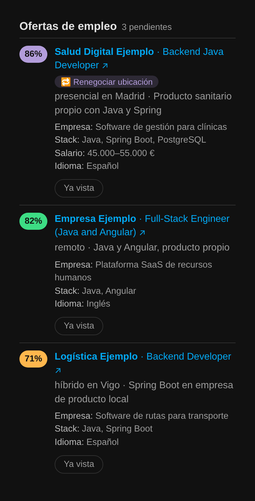
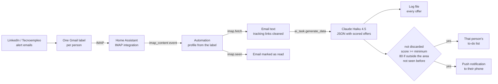

# Job alert bot for Home Assistant

A Home Assistant automation that reads job-alert emails, asks Claude to score every offer against a profile, and only sends the ones worth applying to. It works for several people at once: my partner and I each have our own profile, list and phone.

I was getting dozens of LinkedIn and Tecnoempleo alerts a day, and most of them didn't match what I was looking for. Now my phone only buzzes for the offers that fit: the kind of company I want, remote work in Spain, and a stack I actually use.

## What you see

### On the phone

Every good offer arrives as a push notification from the Home Assistant app. The title has the company and the score, the text has the role, the work mode and why it fits. Tapping it opens the offer.


```
Empresa Ejemplo · 82 %
Full-Stack Engineer (Java and Angular) (remoto).
Java y Angular, producto propio
```

### In Home Assistant

Each person's offers are saved in their own to-do list, and shown with a custom card ([`card/ofertas-card.js`](card/ofertas-card.js)):



- Best scores on top, with the full text. The built-in to-do card cuts descriptions after two lines.
- **Tapping the title opens the offer.**
- **Ya vista** ("seen") ticks the offer in the list. It disappears from the card, but the bot remembers it and never sends it again.
- Offers marked **🔁 Renegociar ubicación** are very good companies in the wrong place (see below).

## What it does

- **Reads alert emails** from one Gmail label per person over IMAP, as soon as they arrive.
- **Picks the right profile** from the label: each person has their own prompt, to-do list, minimum score and phone.
- **Extracts every offer** in the email (company, role, work mode, link) with Claude Haiku 4.5, through Home Assistant's `ai_task.generate_data`.
- **Scores each offer from 0 to 100** against that person's profile and rules.
- **Skips what you're not interested in**: companies from a list you write yourself, areas, conditions or places.
- **Puts offers outside your area in a separate group.** An onsite job in Madrid can't be an 80 % match for someone who wants to work remotely from Galicia, but a great company might still be worth a conversation. These offers are scored as if they were remote, only reach the phone above a higher score (80) and arrive marked as *🔁 Renegociar* ("renegotiate").
- **Adds extra details** to each offer: what the company does, stack or requirements, salary and language, only when the email says so. The prompt tells the model not to invent them.
- **Keeps a to-do list** per person with every good offer, and never adds the same offer twice.
- **Sends a push notification** to that person's phone with the score and a link to the offer.
- **Keeps a permanent log** of every offer it reads, sent or not, with the score and the reason. I use it to check whether the rules discard offers they shouldn't.

## How it works



Everything runs inside Home Assistant. There is no server: one automation in YAML ([`automation/job_alert_bot.yaml`](automation/job_alert_bot.yaml)) and one optional card in JavaScript.

The YAML in this repo is a template: the profiles, the search criteria and the lists of companies are left empty, with a comment in each block explaining what to write. The comments use Jinja's `{# ... #}`, so Home Assistant removes them before the prompt reaches Claude. The settings of each person (list, minimum scores and phone) are in one `perfiles` block at the top.

## Example

For one offer, Claude returns something like this ([full example](examples/ai_output_example.json)):

```json
{
  "empresa": "Empresa Ejemplo",
  "puesto": "Full-Stack Engineer (Java and Angular)",
  "modalidad": "remoto",
  "descartar": false,
  "renegociar": false,
  "puntuacion": 82,
  "motivo": "Java y Angular, producto propio",
  "sobre": "Plataforma SaaS de recursos humanos",
  "stack": "Java, Angular",
  "salario": "No indicado",
  "idioma": "Inglés"
}
```

And the log gets one line per offer ([example](examples/registro_ejemplo.txt)):

```
2026-11-10 09:42 {"persona": "yo", "empresa": "Empresa Ejemplo", "puesto": "Full-Stack Engineer (Java and Angular)", "nota": 82, "descartar": false, "renegociar": false, "aviso": true, ...}
```

The prompt and the output are in Spanish because we are looking for jobs in Spain.

## Problems I hit and how I solved them

- **The model ran out of output tokens.** LinkedIn emails are full of very long tracking links. A regex in the template removes everything after `?` in each URL, which took one email from 10,325 to 2,440 characters.
- **Vague offers got good scores.** Many alerts don't mention the stack. I added a rule: if the stack is not in the email, the score can't go above 55 unless the title says Java, Spring, Angular or React.
- **Small companies slipped through.** The model knows big companies, but not small ones. Companies to skip have to be listed by name, including their old brand names.
- **False positives.** Short names can match other companies with a similar name. The list uses full names.
- **The model copied the example text.** For the work mode it sometimes wrote "remoto / híbrido en ..." literally. The format now says "only one option" and uses `<ciudad>` as a placeholder.
- **The model said one thing and did another.** In the reason it wrote "this company is a recruiter", but it didn't mark the offer as discarded. A rule now says: if you call it a company we skip, `descartar` must be true.
- **Great offers in the wrong city looked like good matches.** An onsite job in Madrid got 72 % because the company and the stack were right. Now those offers get their own flag (`renegociar`), a higher minimum score and a different notification, instead of looking like normal matches.
- **Duplicates.** The same offer arrives in several emails. The bot reads the to-do list first and skips any company + role it has already added.
- **Sorting.** The built-in to-do card can only sort by name, so each item starts with the score padded to two digits (`82 % · Company – Role`). The custom card sorts by that number.
- **The built-in card cut the text and hid the link.** It only shows the first lines of the description, so the link at the end never showed up. That's why I made the custom card, where the title is the link.
- **Only the newest email triggered the bot.** When many alerts arrive at once, the IMAP integration fires one event for the newest unread email only. Since the bot marks each email as read when it finishes, the next one becomes the newest and fires again, so the backlog empties itself one email at a time. The automation runs in `queued` mode so no run is dropped.
- **Home Assistant only keeps the last 5 runs.** That wasn't enough to review what the bot did over a few days. The automation now keeps 50 traces, and the log file keeps everything.
- **IMAP folder not found.** Home Assistant didn't accept a Gmail label with spaces. Renaming it to `AlertasEmpleo` fixed it.

## Setup

See [docs/setup.md](docs/setup.md). In short:

1. A Gmail label per person, with a filter for their alert senders, and an app password.
2. One IMAP integration entry per label.
3. The Anthropic integration with an AI Task entity (Claude Haiku 4.5, max tokens 4000).
4. A Local To-do list per person.
5. The Home Assistant app on each phone.
6. Optional: the File integration for the log, and the custom card.
7. Paste the automation, fill in the `perfiles` block and write each profile in the prompt.

## How I built it

I built this with [Claude Code](https://claude.com/claude-code) and Claude, in conversation. I didn't write the YAML or the card by hand. My part was deciding what the bot should do and testing it with real emails:

- what counts as a good offer for each of us, and the rules for scoring it;
- which companies to skip, after looking up each one;
- reading the automation traces and the log when something went wrong, and deciding the fix (token limit, thresholds, duplicates, offers outside our area, the card).

## Ideas for later

- A daily summary instead of one notification per offer.
- Reading the full job description, not only the alert email, to score offers that don't say much.
- Learning from the offers we actually apply to.

## License

MIT
